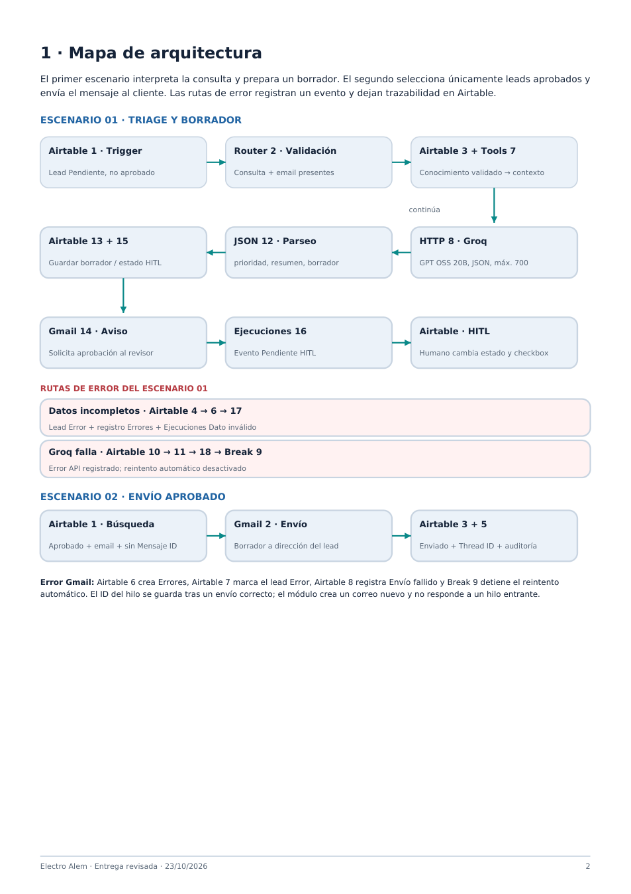
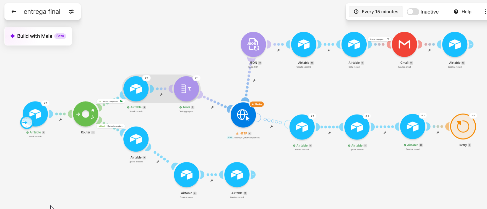
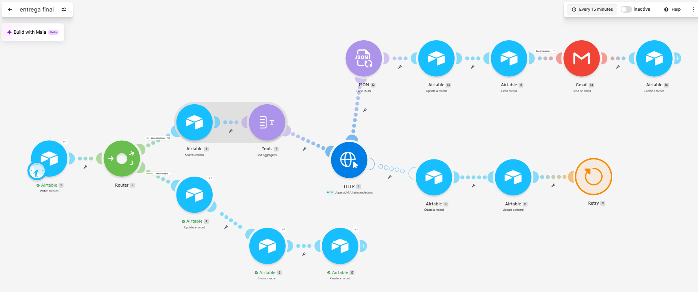
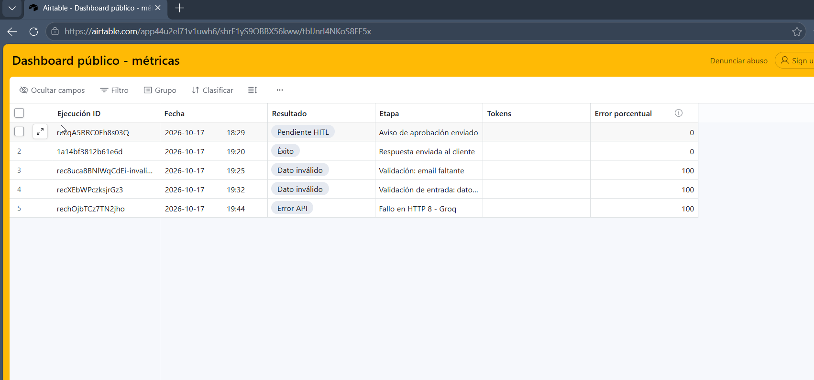
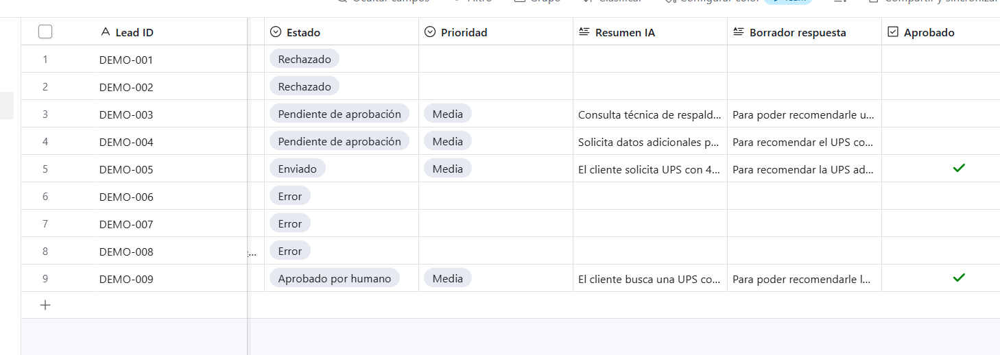
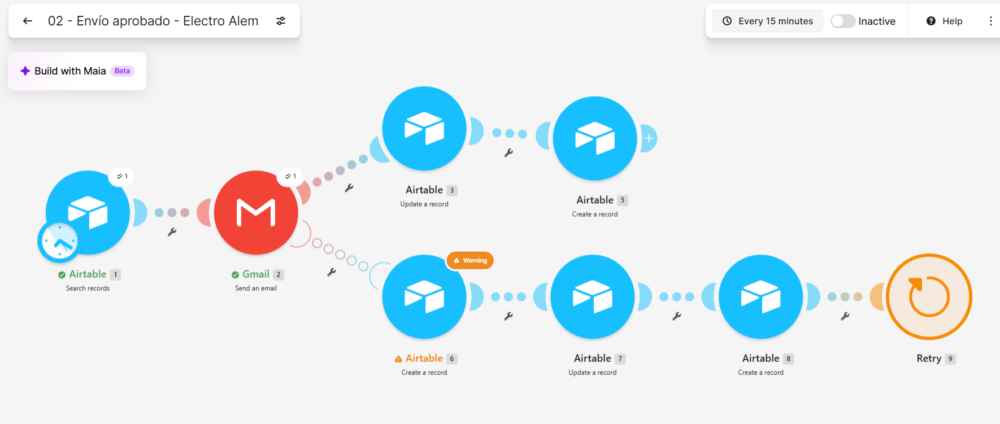

# Entrega final: Ecosistema de automatización IA para Electro Alem

**Autor: Leonardo Cobelas. Revisión: 23/10/2026.** Make + Airtable + Groq + Gmail. Groq fue autorizado por el docente para esta entrega.

**[Documento completo en PDF, 10 páginas](documentacion/Entrega_Final_Ecosistema_IA_Electro_Alem.pdf)** · **[Video](https://drive.google.com/file/d/1zfqT3b52pjDa-w2fn1346BZXJNmSKMsj/view?usp=sharing)** · **[Shared View de control](https://airtable.com/app44u2el71v1uwh6/shrF1yS9OBBX56kww)**

El PDF contiene el desarrollo de los cinco criterios, las capturas y los enlaces directos. También incorpora los dos blueprints y el esquema como adjuntos, para lectores PDF que permitan extraer archivos.

| Criterio | Ubicación en el PDF |
| --- | --- |
| Arquitectura visual | Página 2 |
| Tablas relacionadas y contratos JSON | Páginas 3 y 4 |
| Matriz de costos y ahorro | Página 5 |
| Seguridad, errores y aprobación humana | Página 6 |
| Control, KPIs y pruebas | Páginas 7 y 10 |
| Video y respaldos descargables | Página 9 |

## 1. Arquitectura y caso de uso

El sistema interpreta consultas comerciales sobre UPS y prepara una respuesta. El escenario 01 vigila registros nuevos Pendiente sin aprobación; valida Consulta y Email, recupera Conocimiento validado, agrega el contexto y llama a Groq mediante HTTP 8. Parse JSON extrae prioridad, resumen y borrador. Airtable guarda el resultado en Pendiente de aprobación; Gmail notifica al revisor y Ejecuciones conserva el evento.

El revisor lee o corrige el borrador, marca Aprobado y selecciona Aprobado por humano. El escenario 02 busca registros aprobados con Email, Borrador y Mensaje ID vacío. Envía por Gmail, guarda Enviado, Mensaje ID y Thread ID y registra Éxito. La espera humana queda persistida en Airtable entre ambos escenarios.



## 2. Manual operativo de datos y JSON

Base: **Entrega Final IA - Leads Electro Alem (pruebas)**.

| Tabla | Campos principales y tipos | Relación |
| --- | --- | --- |
| Leads | Lead ID, Consulta, Resumen IA y Borrador respuesta: texto; Estado y Prioridad: selección; Aprobado: checkbox; Email y Email aprobador: correo; Mensaje ID y Thread ID: texto | Conocimiento, Ejecuciones y Errores |
| Conocimiento | Tema, Contenido validado, Categoría, Versión y checkbox Validado | Leads vinculados |
| Ejecuciones | Ejecución ID, Fecha, Resultado, Etapa, Tokens y Error porcentual | Lead de cada evento |
| Errores | Error ID, Módulo, Código, Mensaje resumido y Estado | Lead afectado |

Estados normales: Pendiente → Pendiente de aprobación → Aprobado por humano → Enviado. Error y Rechazado interrumpen el camino normal. Make crea los eventos con el ID del lead en el campo de enlace. La relación Leads↔Conocimiento existe, pero el flujo actual no escribe automáticamente qué fuentes se usaron por lead.

Ejemplo de entrada Airtable → Make, con datos ficticios:

```json
{
  "id": "rec_ejemplo",
  "Lead ID": "DEMO-009",
  "Consulta": "Necesito una UPS para computadora y router",
  "Email": "cliente@example.com",
  "Estado": "Pendiente",
  "Aprobado": false,
  "Email aprobador": "revisor@example.com"
}
```

Ejemplo de petición Make → Groq, con variables dinámicas:

```json
{
  "model": "openai/gpt-oss-20b",
  "messages": [
    {"role":"system","content":"Instrucciones comerciales y salida JSON"},
    {"role":"user","content":"Consulta: {{1.Consulta}}; contexto: {{7.text}}"}
  ],
  "response_format":{"type":"json_object"},
  "reasoning_effort":"low",
  "max_completion_tokens":700
}
```

Make extrae `8.data.choices[].message.content` y parsea el contenido JSON:

```json
{
  "prioridad": "MEDIA",
  "resumen": "Consulta por respaldo con UPS",
  "borrador_respuesta": "Indique el consumo y la autonomía requerida."
}
```

Prioridad admite ALTA, MEDIA o BAJA; resumen y borrador son texto. El prompt pide hasta 35 y 100 palabras respectivamente. Gmail usa Email y Borrador respuesta del registro; Airtable guarda `2.threadId` y `2.id`. El módulo crea un correo nuevo; no responde a un hilo entrante.

[Esquemas JSON formales de las integraciones](documentacion/esquemas_transferencia.json). Los ejemplos explican los contratos; los blueprints conservan los mapeos reales.

## 3. Matriz de costos y elección del modelo

Precios de referencia consultados el **17/10/2026**, en USD por millón de tokens. Supuesto comparable: 1.000 consultas de 800 tokens de entrada y 300 de salida; excluye Make, Airtable, Gmail e impuestos. Es una estimación, no consumo facturado.

| Tarea y alternativa | Entrada/M | Salida/M | USD/1.000 consultas | Decisión |
| --- | ---: | ---: | ---: | --- |
| Triage y borrador: GPT OSS 20B en Groq | 0,075 | 0,30 | 0,150 | Implementado: salida JSON y costo reducido |
| Lectura compleja: GPT OSS 120B en Groq | 0,15 | 0,60 | 0,300 | Alternativa si una evaluación exige mayor calidad |
| Reprocesos masivos: 20B Batch | 0,0375 | 0,15 | 0,075 | Alternativa diferida; no implementada |

Cálculo 20B: `0,8 × 0,075 + 0,3 × 0,30 = USD 0,15`. Ahorro frente a 120B: **50 %**. Batch ahorraría otro **50 %** frente al 20B síncrono, con espera de procesamiento.

Fuentes oficiales: [modelos Groq](https://console.groq.com/docs/models), [20B](https://console.groq.com/docs/model/openai/gpt-oss-20b), [120B](https://console.groq.com/docs/model/openai/gpt-oss-120b) y [Batch](https://console.groq.com/docs/batch). Son valores históricos y pueden cambiar. El flujo limita la completación a 700 tokens y filtra campos vacíos antes de la IA. Tokens todavía no se completa automáticamente en Ejecuciones; no se afirma medir gasto real.

## 4. Seguridad, resiliencia y HITL

| Control | Implementación |
| --- | --- |
| Minimización | El prompt usa Consulta y texto validado; no requiere el nombre ni el email del cliente para clasificar |
| Credenciales | Conexiones administradas por Make; los blueprints omiten la etiqueta personal de Gmail y no contienen una clave Groq literal detectada |
| Anti bucle | Escenario 01 filtra Pendiente y no aprobado; escenario 02 exige aprobación, Email, borrador y Mensaje ID vacío |
| Tipos y variables | Aprobado es checkbox; Estado se compara con texto; consulta, contexto y destinatarios se mapean desde registros |
| Aprobación humana | Gmail notifica; el revisor cambia Estado y Aprobado en Airtable antes del envío |
| Datos incompletos | Airtable 4 → Errores 6 → Ejecuciones 17; marca Error y registra Dato inválido |
| Fallo Groq | HTTP 8 → Errores 10 → Lead Error 11 → Ejecuciones 18 → Break 9 sin reintento automático; probado con DEMO-008 |
| Fallo Gmail | Gmail 2 → Errores 6 → Lead Error 7 → Ejecuciones 8 → Break 9; configurado, sin prueba negativa Gmail documentada |

Si Gmail entrega y luego falla Airtable antes de guardar Mensaje ID, hay que conciliar el mensaje antes de reintentar para evitar un duplicado. La revisión humana no garantiza exactitud técnica.





## 5. Dashboard de control y pruebas

**[Abrir Shared View pública de auditoría, solo lectura](https://airtable.com/app44u2el71v1uwh6/shrF1yS9OBBX56kww)**. Expone registros de control, Resultado, Etapa y Error porcentual. El enlace apunta a la vista compartida, no al editor privado.

Error porcentual es 100 para Dato inválido, Error API o Envío fallido, y 0 para los demás resultados. Su promedio mide errores por evento.

| KPI, corte verificado en Airtable el 23/10/2026 | Valor |
| --- | ---: |
| Eventos auditados | 7 |
| Éxito | 2 |
| Pendiente HITL | 2 |
| Dato inválido | 2 |
| Error API | 1 |
| Eventos con error | 3 |
| Tasa por evento | **3/7 × 100 = 42,86 %** |

Un mismo lead aporta eventos de aprobación y de envío. La tasa incluye fallos provocados y no mide confiabilidad de producción. La captura inferior es histórica: cinco eventos y 60 % el 17/10. El registro actual incorpora DEMO-009; la página 10 del PDF documenta los siete eventos. La tasa agregada se calcula sobre los registros; no se presenta la captura histórica como un tablero actualizado.



| Caso | Resultado comprobado |
| --- | --- |
| DEMO-004 | Consulta válida; borrador y aviso, versión inicial sin evento de Ejecuciones |
| DEMO-005 | Aprobación y envío; segunda ejecución sin duplicado |
| DEMO-006 | Email faltante; evento de Ejecuciones reconciliado manualmente |
| DEMO-007 | Consulta faltante; ruta automática Dato inválido |
| DEMO-008 | Modelo Groq inexistente; Error API automático; modelo válido restaurado |
| DEMO-009 | Proceso programado: aviso HITL el 17/10 a las 20:35:42 y envío tras aprobar el 18/10 a las 16:57:58, hora argentina |

DEMO-009 fue consultado el 23/10 en Airtable: **Estado Enviado, Aprobado=true, Mensaje ID y Thread ID `1a15097a57e2e691`**. El usuario aportó capturas de aprobación y recepción. Las capturas de Make del 17/10 muestran Inactive porque preceden la activación y la prueba automática del 18/10.





## Video y respaldos técnicos

- [Video MP4 en Drive](https://drive.google.com/file/d/1zfqT3b52pjDa-w2fn1346BZXJNmSKMsj/view?usp=sharing): archivo y permiso anyone/reader verificados el 23/10. No se reprodujo en esta revisión documental; no se valida aquí duración ni audio.
- [PDF completo, diez páginas](documentacion/Entrega_Final_Ecosistema_IA_Electro_Alem.pdf).
- [Blueprint 01: triage y aprobación](blueprints/entrega_final_01_sanitizado.blueprint.json).
- [Blueprint 02: envío aprobado](blueprints/entrega_final_02_sanitizado.blueprint.json).
- [Esquemas JSON](documentacion/esquemas_transferencia.json).
- [Capturas de evidencia](evidencias/).

Para reproducir: importar ambos blueprints en Make, reconectar Airtable/Groq/Gmail, revisar HTTP y Parse JSON, y remapear IDs de base y tabla si cambia la cuenta. Cargar Consulta, Email y Email aprobador, Estado Pendiente y Aprobado sin marcar; esperar el borrador; revisar y aprobar; comprobar Enviado, IDs y auditoría. Los blueprints no transfieren credenciales ni certifican por sí solos que la programación esté activa.
